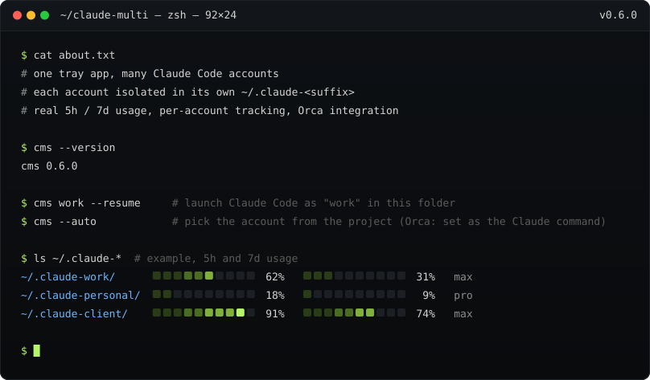
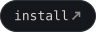
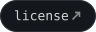
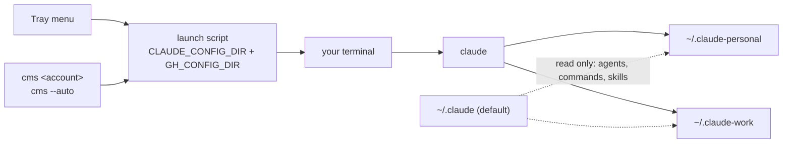
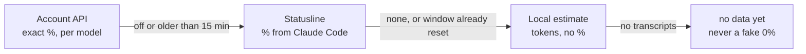
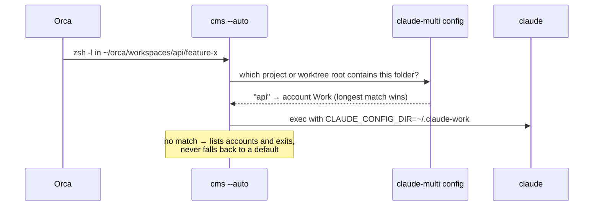
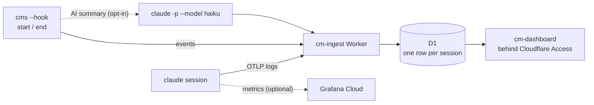

<p>
  <a href="#install"></a>
  <a href="#preferences"></a>
  <a href="#real-usage"></a>
  <a href="#session-tracking"></a>
  <a href="#using-with-orca"></a>
  <a href="CHANGELOG.md"></a>
  <a href="LICENSE"></a>
</p>

a system-tray app (macOS, Linux, Windows) that runs [Claude Code](https://claude.ai/code) under **several accounts at once**, without logging out and back in. personal and work side by side, credentials and history never mixed, and your default `~/.claude` never touched.

---

## How it works

every account gets its own `CLAUDE_CONFIG_DIR`. the tray (or the `cms` CLI) opens a terminal with that dir exported and runs `claude`:



- **one login per account**, then no re-auth. credentials live in a separate Keychain entry (macOS) or `.credentials.json` (Linux/Windows) per dir.
- **`gh` is isolated too**: `GH_CONFIG_DIR=<config_dir>/gh`, so a `gh auth switch` in one account never leaks into another. run `gh auth login` once per account.
- **your `~/.claude` resources are shared**: agents, commands, skills and output styles can be linked into every account dir (you choose per resource). the default dir is only ever read.

| Concept | What it is |
|---|---|
| **Account** | a label + a `~/.claude-<suffix>` dir |
| **Project** | a folder that belongs to **one** account |
| **Session** | `claude` running under an account, in a project or not |

---

## Install

grab the bundle for your OS from [Releases](https://github.com/Lukeneo12/claude-multi/releases) (macOS: `aarch64` for Apple Silicon, `x64` for Intel).

> **macOS says "claude-multi is damaged"?** the builds are unsigned, not broken. clear the quarantine once:
> `xattr -dr com.apple.quarantine /Applications/claude-multi.app`

or run it from source (needs the `claude` CLI, Node 18+ and stable Rust):

```sh
npm install
npm run tauri dev       # a tray icon appears; there is no main window
npm run install-cli     # optional: installs cms to ~/.local/bin
```

**first run:** tray → **Preferences…** → add your accounts and projects → **Save** → tray → *Account* → **Login…** once per account. done.

---

## The tray

```
Personal ▸
  New session                 ← claude under this account, no project
  my-backend                  ← this account's projects
  Open in Orca ▸              ← macOS, when Orca is installed
  ──────────────
  ✓ you@example.com           ← logged in (or "Login…")
  Re-login…  /  Log out
Preferences…
Quit
```

the menu refreshes live after Save and on hover (hover is macOS/Windows only).

## Preferences

one window, five tabs, a single **Save** for all of them:

| Tab | What you do there |
|---|---|
| **Accounts** | see each account's login and usage, log in or out, add or edit accounts |
| **Projects** | map folders to accounts, choose which `~/.claude` resources to inherit |
| **Tracking** | opt-in session analytics |
| **Orca** | health check and repo import (only when Orca is installed) |
| **Settings** | terminal, statusline recording, Account API |

terminals: Terminal.app, iTerm2 and Warp on macOS; GNOME Terminal and Konsole on Linux; Windows Terminal and PowerShell on Windows. if the terminal can't open, the command is copied to your clipboard instead.

---

## Real usage

each account shows how much of its **real** 5-hour and 7-day limits you've used. per window, the first source that has data wins:



- **statusline (on by default)**: claude-multi registers `cms --statusline` in each account's `settings.json`. your own statusline keeps working (it's chained) and comes back as it was if you turn the toggle off.
- **Account API (off by default)**: an undocumented Anthropic endpoint that adds per-model limits and your plan. it reads your own token, read-only, and never refreshes or stores it. this is a terms-of-service grey area, so read the warning in Settings first.
- vessels turn amber at 60% and red at 85%. pacing chips tell you whether you're ahead of the clock.

details: [docs/guide/usage.md](docs/guide/usage.md)

---

## CLI (`cms`)

```sh
cms personal          # fuzzy match: "cms pers" works too
cms work --resume     # extra args go straight to claude
cms --auto            # pick the account from the current folder
```

same login gate, inheritance and tracking as the tray. logged out or expired? it refuses and tells you how to log in.

---

## Using with Orca

[Orca](https://github.com/stablyai/orca) runs agents in worktrees. set its Claude command to `cms --auto` and every project uses **its own** account:



1. put `cms` on the login-shell `PATH` (`zsh -lc 'command -v cms'`).
2. in Orca: Settings → Agents → Claude → Command = `cms --auto`.
3. in Preferences → **Orca**: **Import from Orca…** maps your repos and their worktree roots to accounts.

on macOS you also get a health check and **Open in Orca** in the tray. claude-multi only ever *reads* Orca, it never writes its files. details: [docs/guide/orca.md](docs/guide/orca.md)

---

## Session tracking

**off by default.** turn it on and every session reports to a backend **you deploy on your own Cloudflare account**, plus optional Grafana Cloud metrics:



- **metadata only**: account, host, IP and coarse geo, project, branch, duration, tokens, cost, models. prompt and response text is not requested.
- **AI summary is a separate toggle**: it *does* send the transcript to Anthropic and spends tokens of that account.
- hooks never block Claude Code; failed deliveries are queued locally and retried.

details: [docs/guide/tracking.md](docs/guide/tracking.md) · backend setup: [cloud/README.md](cloud/README.md)

---

## Security, in short

- writes only to the `~/.claude-<suffix>` dirs you configure, **never** to `~/.claude`.
- launch scripts are shell-escaped, created atomically, owner-only, with unguessable names.
- `settings.json` is never written through a symlink; your original statusline is backed up and restored.
- the OAuth token is read-only and only ever sent to Anthropic's API.
- with tracking on, its tokens live in the launch script and the session environment (same-user secrets).

---

## Development

```sh
cd src-tauri && cargo test && cargo clippy --all-targets -- -D warnings
npm test && npm run build
```

architecture and conventions: [CLAUDE.md](CLAUDE.md) · building bundles, signing and the header image: [docs/guide/building.md](docs/guide/building.md) · manual checks: [docs/SMOKE-CHECKLIST.md](docs/SMOKE-CHECKLIST.md)

**known caveats:** no hover refresh on Linux; builds are unsigned and each OS builds its own bundle.

## License

[MIT](LICENSE) © Lucas Donadio.
